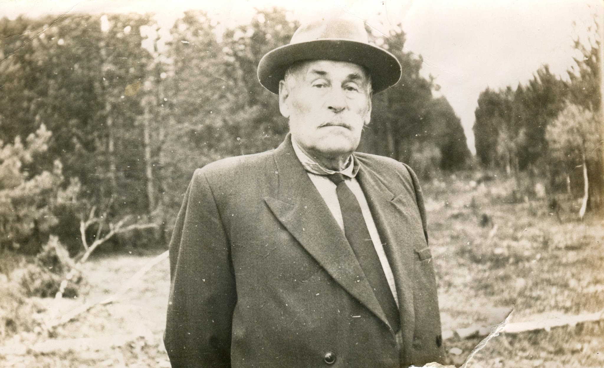
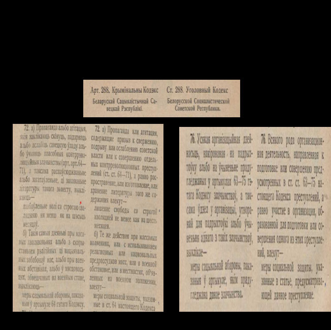
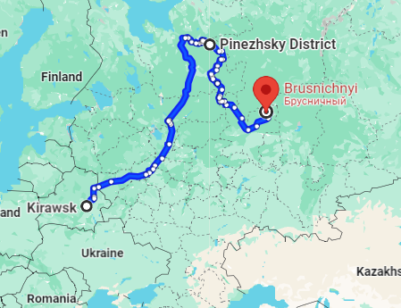
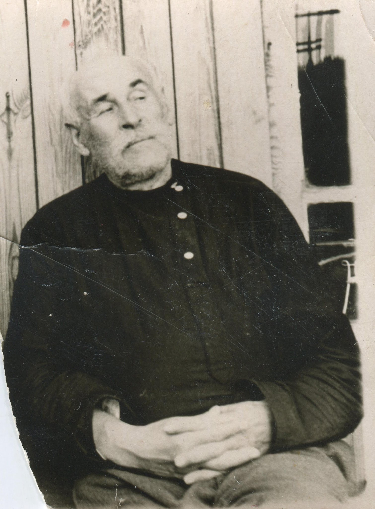

## Осуждение

Постановлением Особой тройки НКВД по Белорусской Социалистической Советской Республике от 4 октября 1937 года Иван Акулович был осуждён на 10 лет лишения свободы.

Срок исчислялся с 5 августа 1937 года по 5 августа 1947 года.

*Иван Акулович Киселёв. Фотография из семейного архива.*

*Иллюстрация из исходной страницы памяти.*

## Места отбывания наказания

- **Кулойский исправительно-трудовой лагерь НКВД**, Красноборское отделение, Пинежский район, Архангельская область. С 1937 по 1943 год.
- **Вятский исправительно-трудовой лагерь МВД (ранее НКВД) СССР.** С 16 августа 1943 года до окончания срока.

*Карта из исходной страницы памяти.*

## Семья

К моменту осуждения у Ивана Акуловича были жена Зинаида и трое детей: Анна (родилась в 1924 году), Анатолий (в 1930 году) и Параскева (в 1931 году). Они остались в Могилёвской области и пережили Великую Отечественную войну.

## Реабилитация

13 апреля 1957 года Президиум Могилёвского областного суда отменил постановление Особой тройки от 4 октября 1937 года и прекратил дело в отношении Ивана Акуловича.

В 1992 году сын Ивана Акуловича, Анатолий Иванович, получил справку Могилёвского областного суда от 27 августа 1992 года № 44у за подписью председателя суда. В ней были изложены эти обстоятельства и сообщалось о реабилитации Ивана Акуловича.

*Иван Акулович Киселёв. Фотография из семейного архива.*
